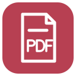

  

<h1 align="center">Craft Editors</h1>

  Spreadsheets, documents, presentations, PDFs and vector drawings, 
  edited right inside VS Code tabs.

  &nbsp;
  &nbsp;
  &nbsp;
  &nbsp;
  

Open and edit spreadsheets, documents, presentations, PDFs and vector drawings in VS Code or a compatible Cursor build. This independent community project embeds the open-source Craft applications in editor tabs. Document processing runs in the editor session, including a remote extension host when using Remote SSH.

> [!WARNING]
> **Early preview.** Use copies of important files. Complex formatting and full file-format compatibility are still being tested. This project is not an official ArtCraft product.

## Highlights

- **Five editors, install only what you need.** Each extension carries its own engine and works without the others.
- **Native editing in VS Code.** Standard Save, Save As, Undo, Redo and Revert, and the editors follow VS Code's light/dark theme.
- **Works over Remote SSH.** Install the extension on the SSH host; documents are processed there, in the editor session.
- **Agent-ready.** Each editor ships an MCP bridge so compatible agents can work with open and closed documents.
- **Multilingual.** Hebrew text, including niqqud, is bundled and tested.

## Choose an editor

Install only the editors you need; each includes its own engine and works without the others.

| | Editor | Files | What you can do |
| :---: | --- | --- | --- |
|  | **Craft Spreadsheets** | `.xlsx`, `.csv`, `.tsv` | Edit cells and formulas, sort data, and use native worksheet tabs. |
|  | **Craft Documents** | `.docx` | Read and edit documents. |
|  | **Craft Presentations** | `.pptx` | Read and edit presentations. |
|  | **Craft PDF** | `.pdf` | Read PDFs and use supported editing tools. |
|  | **Craft Vector** | `.svg`, `.vectorcraft` | View and edit vector drawings. |

An optional  **Craft Editors** pack groups the five extensions. Legacy `.doc` and `.ppt` and password-protected documents are not supported by this preview. Starting with beta 0.1.3, the editor limits files to 256 MiB by default; earlier previews use 32 MiB. For the newer preview, each app has a setting such as `craft.spreadsheets.maxFileSizeMiB` or `craft.pdf.maxFileSizeMiB` (up to 1024 MiB). Large or complex documents can consume substantially more memory than their file size.

## Install

1. Download the desired VSIX files from the [latest beta release](https://github.com/yairkl/craft-editors/releases). Desktop VS Code 1.102 or newer, or a compatible Cursor build, is required.
2. Open the Extensions view, select **… → Install from VSIX…**, and choose each downloaded file. Reload when prompted. No Rust, Node.js or standalone Craft app is needed.
3. Open a supported file. To use Craft Vector for an SVG or `.vectorcraft` file, choose **Reopen Editor With… → Craft Vector**. For Remote SSH, install the desired extension on the SSH host and reload the remote window.

The extensions are not yet published to the VS Code Marketplace or Open VSX. For the optional Suite in this beta, install its five member VSIX files first. See [installation details and preview limits](docs/releases/v0.1.3-beta.1.md).

## Working with files

Use VS Code Save, Save As, Undo, Redo and Revert. The editors follow VS Code's light/dark theme. Spreadsheet, Word and PowerPoint ribbons start collapsed; select a tab to show their tools.

Use the editor title buttons to switch an open CSV or TSV between text and spreadsheet views. CSV and TSV store plain values, not workbook features such as formulas, formatting or extra worksheets. You can still use those features in the editor; when needed, **Save as XLSX** appears so you can keep them. Value edits and sorting can be saved to CSV or TSV. See the [spreadsheet guide](packages/spreadsheets/README.md) for details.

PDF opens in reading mode, with editing tools available. PowerPoint Reading View works inside the editor; full-screen slideshow and Presenter View are not supported in this preview.

## Languages and accessibility

Hebrew text support, including niqqud, is bundled and tested across the five editors. Font, input, shaping and accessibility coverage varies by script and application. See [language and font support](docs/languages.md) for the tested scope and how to request additional languages.

## Agent tools

Each editor includes an MCP bridge intended to give compatible agents access to open and closed documents. MCP discovery has been verified in VS Code and Cursor. A test client also exercises the bridge in a Linux Remote SSH host; broader real-client editing and remote workflows still need validation. See the per-editor guides for [spreadsheets](packages/spreadsheets/README.md#spreadsheet-tools-for-agents), [Word](packages/word/README.md#document-tools-for-agents), [PowerPoint](packages/powerpoint/README.md#presentation-tools-for-agents), [PDF](packages/pdf/README.md#pdf-tools-for-agents), and [Vector](packages/vector/README.md#vector-tools-for-agents).

## Preview limitations and feedback

Complex Office, PDF and SVG fidelity; printing and signing; accessibility and IME input; and wider platform and font coverage are still being validated. An unfinished draft that cannot yet be serialized may not be recoverable after a crash. For details, see the [beta notes](docs/releases/v0.1.3-beta.1.md).

Please [report an issue](https://github.com/yairkl/craft-editors/issues) with your editor and OS versions, file type, and a shareable reproduction. Do not attach private documents. For security vulnerabilities, see [private reporting](SECURITY.md).

## Development and relationship to upstream

See [Contributing](CONTRIBUTING.md) for setup and tests, [design](docs/design.md) for the shared host and adapters, [rendering](docs/rendering.md) for engine builds, and [packaging](docs/packaging.md) for releases. Five separate application extensions share a TypeScript host while each embeds its own pinned Rust/WASM engine. The optional Suite contains no renderer.

This project integrates [GridCraft](https://github.com/storytold/gridcraft), [WordCraft](https://github.com/storytold/wordcraft), [DeckCraft](https://github.com/storytold/deckcraft), [PdfCraft](https://github.com/storytold/pdfcraft), and [VectorCraft](https://github.com/storytold/vectorcraft). Upstream names identify those applications; restricted upstream branding is not redistributed in modified builds.

This repository is licensed under [MIT](LICENSE). Upstream code and bundled assets retain their own licenses and required notices, which are included in the VSIX packages.
